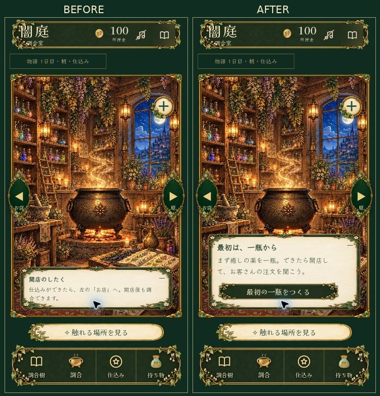
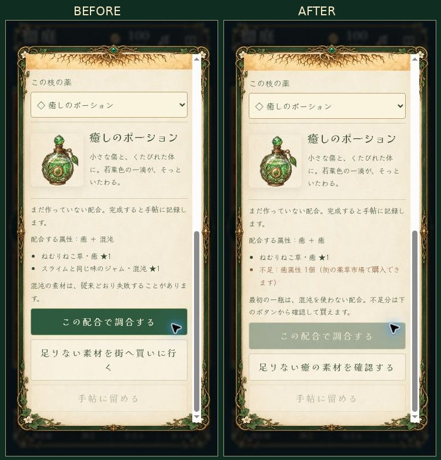
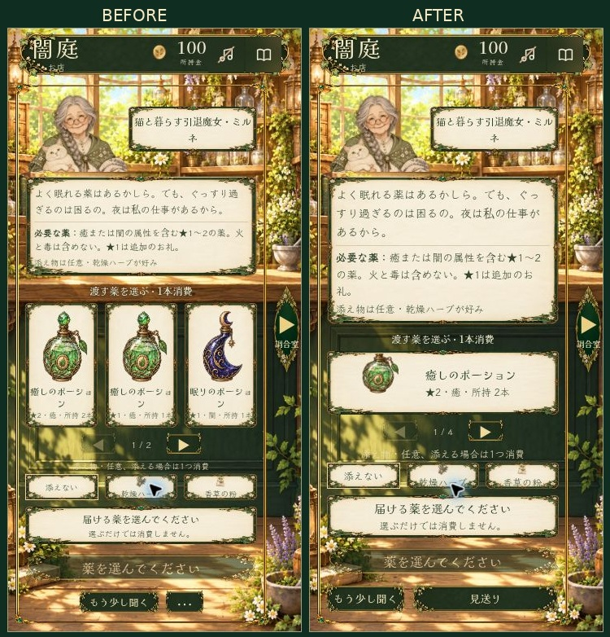
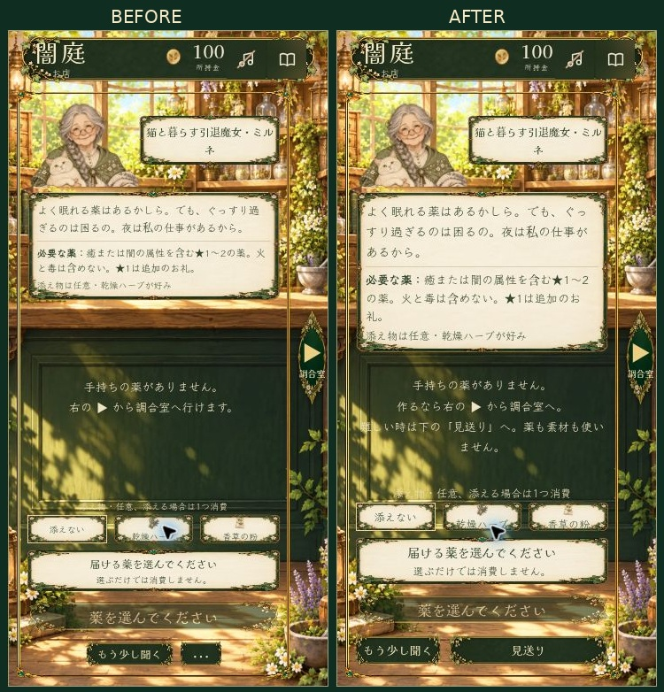

# 初回導線4点の修正比較

**更新：③はユーザー指定で撤回しました。現行v2.28.2は元の3本並列表示・元の文字サイズです。以下の③の右側は撤回した案の記録です。①②④は継続しています。**

左がv2.27.3の実装、右がv2.28系の実装です。360×740相当で、同じ確認データを使ったブラウザ画面。生成した画面案ではありません。通常プレイヤーの保存とは別の名前空間で確認しました。

## 解錠後の次の操作

独り言が畳まれていても、常設の羊皮紙メモに次の操作を表示します。

## 最初の配合

初回は安全な配合が存在する場合、混沌を使いません。不足分は明記し、該当素材の購入確認へ進めます。無料で素材を増やしたり、選ぶだけでコインを使ったりしません。確認データでは10コインで2個を購入し、調合樹へ戻って癒+癒の配合が可能になりました。

## 薬選びの変更案（撤回済み）

当時の案では、スマホを1本ずつの大きな横長カード、薬名14px・属性など12pxとし、広い画面だけ3本表示にしました。以下の右側はこの撤回済みの案です。現行仕様を示す画像としては使用しません。

レビュー後、現行v2.28.2では3本並列・元の文字サイズ・配置へ戻しました。「見送り」の文字表示は維持しています。以下は復帰後の実ブラウザ画面です。

## 薬がない時の見送り

「…」を「見送り」にし、空在庫時に作る/見送るの両方を説明します。見送りボタンは従来の確認欄を開き、押しただけでは依頼を断りません。

現行の関連自動テストは、初回配合の不足/購入後の再計画、スマホを含む3本単位のページ送り、表示操作による非消費、受け渡しの二重処理防止を検証します。実機タッチ・全種類の注文の表示確認とは区別します。
