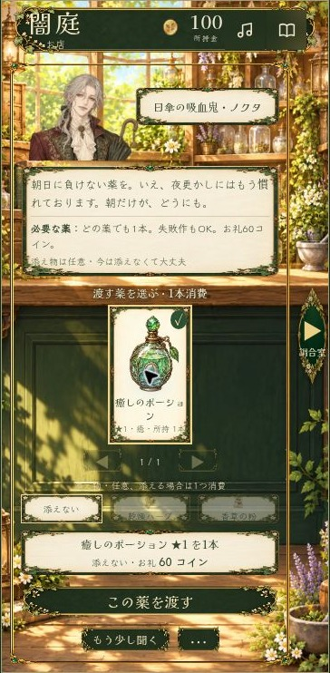

# 初見プレイの確認記録

対象は公開中のWeb版です。本リポジトリ内の旧版コードに対する検証記録ではありません。以下のテスト数・コマンド・ファイル名は現行配信ソースに対応します。

確認日：2026年10月25日。対象：公開版 `/test/`（v2.27.2）と修正版v2.27.3。通常のプレイヤーのセーブを変更せず、同じ配信HTMLを使う確認画面の別名前空間で、新規データから操作しました。

初見で見える文章とボタンから進みました。ただし、制作に関わったAIによる評価であり、ゲームを知らない第三者のユーザーテストを実施したものではありません。

## 実ブラウザで確認した範囲

Chromeの縦画面相当360×740で、主人公選択→祖父の手紙→採取→街の道具屋→4点購入→鍵の3操作→調合樹の配合選択→5工程の調合→開店→初客への受け渡し→2人の見送り→閉店→自室のベッド→2日目の朝まで進行しました。

- 道具購入で200→100コイン。薬を1本完成し、初客へ渡して60コイン獲得。
- 2人目・3人目は、薬が足りない場合の進行経路を確認するため見送りました。3人全員に適合する薬を作って届けた実プレイではありません。
- 調合には画面下のタップ操作を使用。乳棒のドラッグ軌道やスマートフォン実機の長押しは、この確認とは別です。
- 注文が調合室にも表示され、矢印から往復できることを確認。
- 就寝後は2日目・朝・160コイン。朝の自室の挨拶も確認。
- 途中で確認タブのブラウザ応答が一度停止。再読み込み後に新規データでやり直し、同じ工程は通過したため、ゲーム不具合とは断定していません。

## 詰まりかけた場所・気になった点

| 優先度 | 場面 | 初見での迷い・観測した表示 | 状態 |
| --- | --- | --- | --- |
| 高 | 受け渡し後に調合室へ戻る | 完成時の「所持1本」が残り、在庫0本と食い違う。営業中も「開店の準備へ」が残る | v2.27.3で現在の所持数と営業状態に合わせて更新 |
| 中 | 初回解錠の直後 | 「最初の一瓶」の案内が移動後に畳まれ、開店と仕込みの順序を判断しにくい | v2.28.0：常設メモに次の操作を表示 |
| 中 | 最初に調合樹を開く | 初回の採取内容によって、癒しの薬に混沌素材が提案され、失敗の可能性がある | v2.28.0：初回は混沌のない配合と不足素材の購入案内 |
| 中 | 360pxの薬選び | 薬の説明・属性・補足が小さく、読みにくいと評価 | 1本表示を試したがレビューで撤回。現行v2.28.2は元の3本並列・文字サイズ・配置 |
| 中 | 手持ちの薬がない | 調合室へ行く案内はあるが、見送りは「…」の中に隠れる | v2.28.0：「見送り」を常時表示、空在庫時の説明を追加 |
| 低 | 見送り後 | 報酬がないのに「報酬で古道具屋をのぞく」と表示される | v2.27.3で報酬のない場合は「古道具屋をのぞく」へ |
| 中 | 作品をGitHubで見る | ルートREADMEが旧体験版の内容、GAME-READMEには古い操作説明・未確認表記が混在 | 現行紹介に整理し、旧記録は履歴として保存 |

## 自動検証

今回の変更では、完成結果の再表示を現在の所持数で更新する回帰テストを追加しました。売却後の0本、追加後の本数、未登録の所持キー、営業状態ごとのボタン文言を検証し、表示更新が状態を変更しないことを確認します。

検証範囲は[README](README.md#検証記録)を参照してください。現行ソースの全テスト実行は `for test_file in tests/*.test.mjs; do node "$test_file" || exit 1; done` です。テストが通ることと、全端末での表示・音質・すべての遊びを確認したことを混同しません。

## 今回の対象外

105人全員の来店、全料理・全ドリンク、全衣装の組み合わせ、長期日数の実プレイ、Safari/iOS実機、音源の聴感、別端末への引き継ぎ操作は、この一日分のブラウザプレイでは確認していません。

## 検証結果

今回の変更後、Node.jsテスト33本を確認。32本が最初に成功し、自室テスト1本が消える作業用画像への依存で停止しました。承認済み原画のSHA256を固定して外部作業ディレクトリへの依存をなくし、その自室テストと文書整合性テストの成功を確認しました。

## 4点の変更案の確認（v2.28.1・一部撤回済み）

[同じ条件の修正前・修正後画像](CLARITY-COMPARISON.md)を記録しました。解錠後のCTA、不足素材の購入確認→10コイン購入→調合樹へ戻る導線、スマホの1本表示と広い画面の3本表示、画面幅変更時の選択保持、見送り確認欄の表示を実ブラウザで確認しています。変更後の薬を実際に渡して、報酬62コインと残高100→162を確認しました。360×600でも受け渡しと見送りは画面内でした。

### v2.28.2：薬カードの変更を撤回

ユーザーが③を改悪と判断したため、元の3本並列カード・文字サイズ・配置へ復帰。①②④は継続します。上記の1本表示は撤回済みの記録です。

復帰後の実ブラウザ確認では、360px幅で薬カード3本の表示と元の薬名11pxを確認しました。[復帰後の実画面](sales-restored-v2.28.2.jpg)を保存しています。薬カードの変更を読みやすさの改善実績として扱いません。
