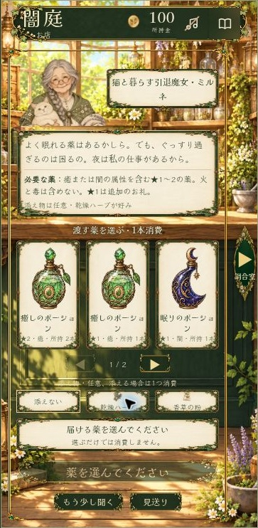
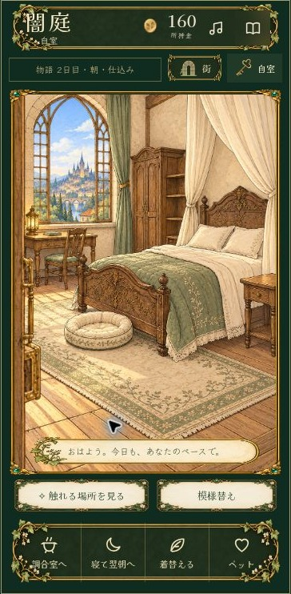

# 闇庭 — Garden of Shadows

薬草を集め、手でポーションを調合し、お客さんの暮らしに一瓶を届けるブラウザゲームです。庭、薬屋、街、自室での日々を、植物の装飾と絵本調のオリジナルイラストで描いています。

**[ゲームを遊ぶ](https://yaminiwa-play-garden.cometauk8.chatgpt.site/test/)** · [制作担当とAI使用範囲](AUTHORSHIP.md) · [設計と改善](DESIGN.md) · [プレイテスト](PLAYTEST.md) · [素材クレジット](CREDITS.md)

<p> </p>

*360×740相当のブラウザ確認から切り出した実画面。接客はv2.28.2の確認用データ、自室は初日から翌朝まで進めたプレイ記録です。生成した画面案ではありません。*

個人制作のブラウザゲームです。企画者が遊び方・世界観・画面の採否を決め、ChatGPT / Codexによる実装・検証・画像生成の支援を受けて制作しています。

## 目指した体験

注文の数値を満たすだけでなく、お客さんがなぜその薬を必要としているのかを聞き、自分の手で一瓶を用意する体験を目指しました。店じまいの後も、焚き火で飲み物を楽しんだり、買った飾りで部屋を整えたりできるようにしています。

スマートフォンの縦画面を主な設計基準に、細かな植物画と日々の操作が両立することを重視しています。

## 遊びの流れ

1. 庭で素材を採り、街の道具屋で調合道具を揃える。
2. 乳鉢で砕く、水を注ぐ、ふいごで火を整える、混ぜる、瓶へ注ぐ。
3. 開店して注文と事情を聞き、条件に合うポーションを届ける。
4. 店じまいの後は焚き火や着替え、部屋の模様替えを楽しむ。
5. 自室のベッドで眠り、翌朝へ進む。

道具に触れる感覚と、少しずつ自分の居場所を作る時間を大切にしています。

## 制作で工夫したところ

| 課題 | 実装した仕組み |
| --- | --- |
| スマートフォンでの注文確認と受け渡しの負担 | 接客の主要情報と操作を一画面に集約し、矢印から調合室へ直接移動 |
| 調合途中に注文を見直したい | 素材選択と作業の途中経過を保ったまま、お店と調合室を往復 |
| 画像とゲーム内の数値が食い違う | 装飾は画像、注文・残高・進捗・操作はHTMLとして分離 |
| 着替えを普段の画面でも楽しみたい | 装備した姿を主人公のひとりごとにも反映 |
| 購入と試着・試し置きが紛らわしい | 試してから確定し、取消では費用を消費しない |
| 更新で進行や所持品を失いたくない | 旧セーブの移行、二重購入、消費のタイミングを自動テスト |

これは実装の狙いです。すべての端末で同じ見え方・操作感を保証するものではありません。確認範囲と課題は[プレイテスト記録](PLAYTEST.md)で公開しています。

初回の「最初の一瓶」への案内や、薬がない時の「見送り」を改善しました。一方、薬を1本ずつ大きく表示する案はレビューで撤回し、3本を見比べられる配置へ戻しています。[設計と改善の記録](DESIGN.md)に、採用した理由と見直した判断をまとめています。

## 実装済みの内容

- 採取・水やり・お手入れ、素材とポーションの管理
- 15種類の現行ポーションと5工程の手動調合。以前の処方と記録も保持
- 105人のお客さんのデータ、注文・会話・受け渡し、ゲーム内の日数による来店
- 男女の主人公、衣装と容姿の変更、小物の試着と購入
- 自室の飾り20種類、6箇所への配置、試し置き・片付け
- 焚き火の焼き物とホットドリンク。庭の料理をタップして食べ、一杯は3口で飲み終わる
- ブラウザ内の自動保存、引き継ぎコード、BGM・効果音・環境音の音量設定

データの種類数と実プレイで全種類を確認した件数は別です。Discord / YAGPDB版との認証・所持品同期、オンライン対戦は未実装です。

## 技術構成とソースの状態

公開中の現行版はHTML / CSS / JavaScriptによる静的Webアプリです。描画にはDOM・Canvas・SVG、音にはWeb Audio、保存にはlocalStorageを使用し、Sitesで配信しています。

**このリポジトリの `index.html` は旧版 v1.6.2です。** このREADMEの作品紹介・画像・制作記録は、上のリンクから遊べる現行版 v2.28.2を対象にしています。今回の更新は紹介文書と確認画像のみで、旧版のゲームコードや音源は置き換えていません。

現行配信ソースでは `dist/test/index.html` を配信正本とし、機能別の `src/` とNode.jsの `tests/` を管理しています。これらのディレクトリは、このリポジトリにはまだ同期していません。文書中の現行ソースのパスと、リポジトリ内のファイルを区別してください。

## このリポジトリの旧版を起動する

```bash
python3 -m http.server 8080
```

リポジトリのルートで実行し、`http://localhost:8080/` を開きます。旧版の `index.html`・音源・書体を同じフォルダに保持してください。現在の作品を体験する場合は、先頭の「ゲームを遊ぶ」から開けます。

セーブはブラウザ内に保存します。端末・ブラウザ・配信元を変える前に、ゲーム内の引き継ぎコードを書き出してください。

## 検証記録

現行版では、Chromeの360×740相当の画面で、新規開始から道具購入・調合・接客・閉店・就寝・翌朝まで進行を確認しました。通常のプレイヤーのセーブとは別の名前空間を使用しています。

現行配信ソースにはNode.jsテスト33本があり、進行・保存・購入・消費のタイミング・UIハンドラなどを確認しています。このリポジトリ内の旧版テストとは構成が異なります。今回の文書更新のためにゲームの全テストを再実行したという意味ではありません。

実機タッチ・音の聴感・全種類の組み合わせ・第三者による初見テストまで確認したものではありません。[実施範囲と対象外](PLAYTEST.md)と[変更前後の記録](CLARITY-COMPARISON.md)を公開しています。

## 制作と素材

- **企画者：** コンセプト、世界観、遊び方と進行の仕様、ビジュアルの方向性、画像とUIの採否、プレイに基づく改善指示。
- **AI支援：** ChatGPT / Codexによる設計案、コードの実装・修正、テスト、文章案。OpenAI画像生成によるオリジナル背景・人物・衣装・装飾などの制作。
- **音源：** 企画者より利用許諾取得済みと確認。作者・出典・利用条件・加工内容は[CREDITS.md](CREDITS.md)と既存の音源台帳に記載。

「オリジナル画像」は本作品向けの制作物であることを示し、手描きのみで制作したという意味ではありません。音源・書体の権利は各権利者に帰属します。リポジトリの閲覧はコード・画像・音源の再利用や再配布の許諾ではありません。

[担当範囲の詳細](AUTHORSHIP.md) / [設計と改善](DESIGN.md) / [プレイテスト](PLAYTEST.md)
